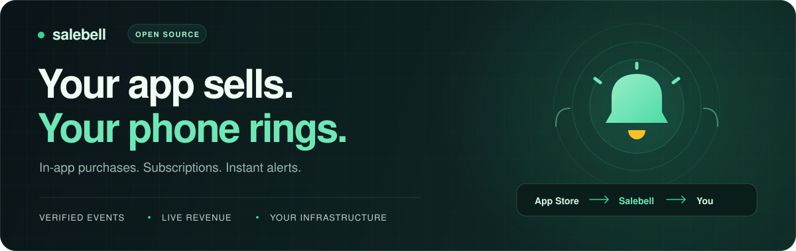
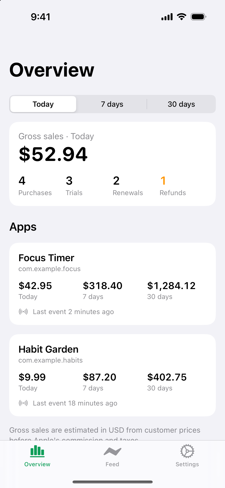
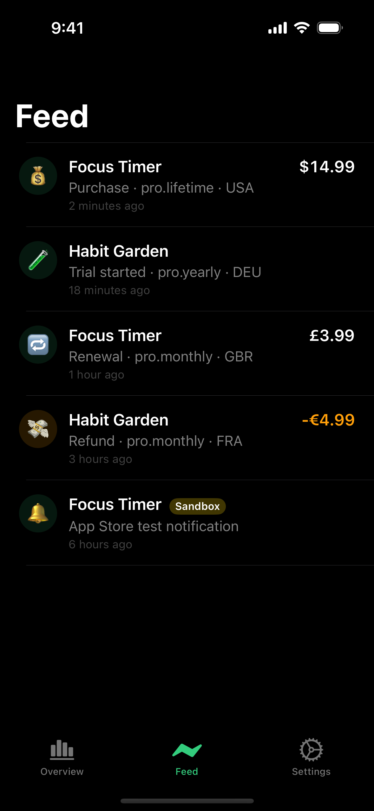
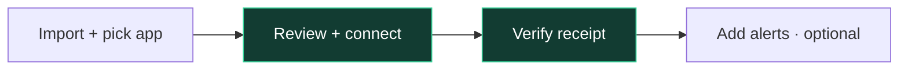
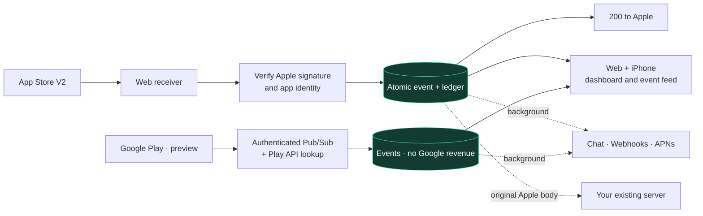

<p align="center">
  
</p>

<p align="center">
  Verified purchase events. Live revenue. A little cha-ching.<br>
  <strong>Keep StoreKit 2. No Salebell SDK required.</strong>
</p>

<p align="center">
  <a href="https://salebell.vercel.app">Try Salebell Cloud</a> ·
  <a href="#develop-locally">Run locally</a> ·
  <a href="#self-host-in-production">Self-host</a> ·
  <a href="docs/SETUP.md">Setup guide</a> ·
  <a href="LICENSE">MIT license</a>
</p>

| 🔔 Hear it | 📊 See it | 🔀 Route it |
| :--- | :--- | :--- |
| iPhone push with a cha-ching sound | Estimated USD revenue, charts, live feed, CSV | Slack, Discord, Telegram, webhooks, PostHog, Pushover |
| Purchases, trials, renewals, refunds, billing issues | Today · 7 days · 30 days | Forward original Apple notifications to your existing server |

**App Store:** in-app purchases and subscriptions; paid-app downloads aren't covered. **Google Play:** [RTDN preview](docs/GOOGLE_PLAY_RTDN.md); event alerts and verified order prices, including renewal and refund accounting. Live Google validation remains pending. No Android companion is included.

## A look inside

<p align="center">
  &nbsp;&nbsp;
  
  <br>
  <sub>iPhone companion · Demo data · Light and dark mode</sub>
</p>

## Pick your starting point

| | You need | Start here |
| :--- | :--- | :--- |
| **Use Cloud** | An email address and your app | [Open Salebell](https://salebell.vercel.app) → [connect an app](#connect-your-first-app) |
| **Develop locally** | Node.js 22.6+, Supabase CLI 2.90+, Docker | [One-command setup ↓](#develop-locally) |
| **Self-host** | Node.js 22.6+, Docker Compose v2, a server and two hostnames | [Production setup ↓](#self-host-in-production) |
| **Host on Vercel + Supabase** | Your own provider accounts | [Hosted installation guide](docs/VERCEL_SUPABASE_DEPLOYMENT.md), including the preview browser installer |

**Self-hosted:** all existing features, no subscription or Stripe. You operate the infrastructure. [Cloud plans](docs/PRODUCT.md#2-cloud-pricing-and-self-hosted-access) apply only to the managed service.

## Develop locally

Install **Node.js 22.6+**, **Supabase CLI 2.90+** and **Docker Desktop** (or a compatible Docker daemon). Start Docker, then:

```sh
git clone https://github.com/salebell/salebell.git salebell
cd salebell
npm run dev
```

Automatically installs web dependencies, starts Supabase, applies migrations, generates `web/.env.local` and runs Next.js + Edge Functions.

| Open | Do |
| :--- | :--- |
| [localhost:3000](http://localhost:3000) | Choose **Email me a code instead** |
| [127.0.0.1:54324](http://127.0.0.1:54324) | Copy the sign-in code from the local inbox |
| [127.0.0.1:54323](http://127.0.0.1:54323) | Inspect users and data in Supabase Studio |

**No provider keys needed to explore.** Real Apple notifications require public HTTPS; push and checkout require provider credentials.

<details>
<summary><strong>Local controls & troubleshooting</strong></summary>

| Task | Command / action |
| :--- | :--- |
| Stop web + functions | `Ctrl+C` (database stays running) |
| Stop database containers, keep data | `npm run dev:stop` |
| Prepare without starting dev servers | `npm run dev -- --setup-only` |
| Test Cloud Free/Pro behavior locally | `npm run dev -- --cloud` |
| Refresh dependencies after an update | `npm ci --prefix web` |
| Existing `web/.env.local` targets a hosted project | Move it aside, then rerun `npm run dev` |
| Docker connection fails | Start Docker and check `docker info` |

Use the production installer below for public instances. [More troubleshooting](docs/SETUP.md#common-first-run-problems).

</details>

## Self-host in production

Run these commands on a server with **Git**, **Node.js 22.6+** and **Docker Engine + Compose v2**. Point **two distinct hostnames** at its public IP and open **ports 80/443**. HTTPS is automatic. No Supabase account, Vercel account, Stripe or email provider is needed.

```sh
git clone https://github.com/salebell/salebell.git salebell
cd salebell

npm run self-host -- init \
  --site-url https://salebell.example.com \
  --api-url https://api.salebell.example.com \
  --email owner@example.com
npm run self-host -- up
```

Wait for **Salebell is ready at ...**, then read your generated password on the server:

```sh
cat deploy/owner-password
```

Open your site's `/login` page. Sign in with your `--email` address and that password. Registration is closed by default. Keep **`deploy/.env`** and **`deploy/owner-password`** private.

```sh
npm run self-host -- status
npm run self-host -- check
npm run self-host -- backup
```

Copy the whole backup directory off-server. `check` verifies internal services; also confirm public HTTPS and a real notification. [Step-by-step installation →](docs/SELF_HOSTING.md) · [Configuration, updates and recovery →](docs/SELF_HOSTING_OPERATIONS.md)

## Connect your first app

Sign in → **Add app**, then:



| Step | What you need |
| :--- | :--- |
| **Import** | App Store Connect **team API key** (`.p8`) + Key ID + Issuer ID. **App Manager** access recommended; Admin supported. |
| **Connect** | Review existing V2 forwarding destinations → **Start receiving notifications**. V1 receivers need manual migration. |
| **Verify** | Sandbox purchase, or Apple test with a separate **In-App Purchase key**. Confirm actual receipt. |
| **Alert** | Chat/webhooks or the optional [iPhone companion](ios/README.md). Recording works without alerts. |

**Without an Apple key:** **Enter app details manually** → name + bundle ID → save existing forwarding URLs → paste Salebell's **Production and Sandbox URLs** into **App Store Connect → App Information → App Store Server Notifications**, both **Version 2**.

[Connection walkthrough](docs/SETUP.md#connect-your-first-app-as-a-customer) · [Apple key permissions](docs/APPLE_AUTOMATION.md) · [Connect Google Play (preview)](docs/GOOGLE_PLAY_RTDN.md)

## How it works



**Reliable:** idempotent recording, ordered Apple state, 503 on database failure. Alert failures don't block Apple's response; events signed over 6 hours ago skip phone alerts.

**Protected:** signature/identity checks, workspace RLS, Apple/Google keys in Vault. Raw Apple JWS isn't stored or logged. OCSP revocation checks and Vault encryption for channel secrets remain unimplemented.

## Go further

| Need | Guide |
| :--- | :--- |
| **Operate your instance** | [Install and sign in](docs/SELF_HOSTING.md) · [SMTP, backups, updates and recovery](docs/SELF_HOSTING_OPERATIONS.md) |
| **Build the iPhone companion** | [Configure backend, signing, APNs & widget](ios/README.md#self-hosted-companion). Self-hosted builds must match your backend and Apple identity. |
| **Deploy your own Cloud service** | [Web environment & deployment](web/README.md) + [owner setup & verification](docs/SETUP.md#configure-a-hosted-deployment-as-the-owner) |
| **Configure optional providers** | [Email, Stripe and APNs setup](docs/SETUP.md#launch-priorities) · [.env.setup.example](.env.setup.example) |
| **Understand product scope** | [Features, Cloud plans and constraints](docs/PRODUCT.md) |
| **Contribute / report a vulnerability** | [Contributing](CONTRIBUTING.md) · [Private security reports](SECURITY.md) |

<details>
<summary><strong>Repository map</strong></summary>

| Path | Purpose |
| :--- | :--- |
| [`web/`](web/) | Next.js dashboard and marketing site |
| [`ios/`](ios/) | SwiftUI companion, push and Today widget |
| [`supabase/functions/_shared/core/`](supabase/functions/_shared/core/) | Runtime-independent verification, event normalization and delivery |
| [`supabase/functions/`](supabase/functions/) | Apple/Google receivers and setup, billing, alerts, account deletion, FX |
| [`supabase/migrations/`](supabase/migrations/) | Schema, tenancy, RLS, ledger and credentials |
| [`deploy/`](deploy/) | Production Compose stack and HTTPS gateway |
| [`scripts/`](scripts/) | Local bootstrap, self-host installer and hosted owner setup |
| [`tests/`](tests/) | Core, handler, installer and SQL checks |

</details>

<details>
<summary><strong>Run checks</strong></summary>

From the repository root, after local setup:

```sh
npm test
npm run test:sql
npm --prefix web test
npm --prefix web run lint
npm --prefix web run build
```

SQL checks create a throwaway database; install PostgreSQL 15+ binaries (`initdb`, `pg_ctl`, `psql`, or set `PG_BIN`). [iOS build & tests](ios/README.md#build-and-run).

</details>

<p align="center"><sub>Built for indie developers and studios. <a href="LICENSE">MIT licensed.</a></sub></p>
