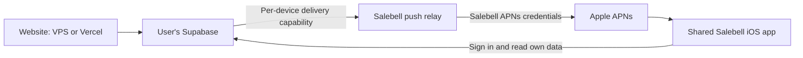

# Deployment and shared iPhone app review — 2026-10-16

## Required experience

An independent installation has two parts:

1. Host the website on a Next.js/Node.js or Docker server (including a VPS), or on Vercel.
2. Connect a Supabase project in the user's own account. Database, Auth, Realtime, Vault and Edge Functions belong to that project.

The required distribution is one shared Salebell iPhone app for managed Salebell and independent installations. Choose Salebell or enter an instance's website URL, Supabase API URL and **public/publishable key**, then sign in to that backend. Users do not build or publish an app, obtain an Apple developer membership, or supply APNs credentials. Service-role keys and Supabase management tokens must never be entered in the phone. Distribution availability still requires operator qualification.

Assumption: one active backend and signed-in user per phone. Switching replaces the active account. Workspace members may receive that workspace's events; unrelated users cannot. Matching emails or UUIDs on different servers do not imply the same identity.

Running Supabase itself with the existing full Docker stack remains an advanced alternative, rather than the primary path for a user who already has a Supabase account.

## Implementation status — updated 2026-10-16

The review initially identified missing runtime configuration and a missing relay. Those historical findings described the repository before this implementation. The shared-app implementation now exists in source; this document does not assert a live relay, App Store publication or physical-device delivery.

| Requirement | Current repository status | Remaining verification |
| --- | --- | --- |
| Vercel + owned Supabase | Guided installer exists; migration-history dollar-quote corruption was corrected with a regression test. | Fresh and interrupted installation against real provider projects. |
| VPS website + owned Supabase | Standalone Next.js deployment and Docker instructions exist; full Compose supplies its private gateway explicitly. | Public HTTPS, Auth and real store notification receipt. |
| Runtime iOS server settings | Website/API/public-key configuration, signed-out access, backend-specific sessions and widget selection generation are implemented. | Signed device behavior when switching accounts and backends. |
| Shared-app push | Operator-only schema, enrollment proof, revisioned routes, capabilities, revocation, APNs encryption and managed web proxy are implemented. Apple, Google and test alerts share transport dispatch. | Deploy/enable the managed service and verify exact signed app/extension on physical devices. |
| Backend recipient isolation | Registration derives `auth.uid()`; copied capabilities cannot transfer an existing registration. Membership, enabled devices, caller-only tests and sandbox preferences remain authoritative. | Real installation smoke tests and periodic production regression checks. |
| Managed upgrade isolation | Enabling the managed relay blocks all legacy direct sends, including unenrolled tokens. No cross-transport fallback exists. | Old companion versions update and re-enroll; prove stale legacy registrations cannot deliver. |
| Switching and Auth loss | Registration drains, central revocation, selection generations and local route clearing are implemented. Offline old-backend cleanup is best effort; failed central revocation blocks a replacement route. | Relay outage, delayed callback, offline-old-backend, deletion and token-rotation device checks. |
| Limiter failure | Test-alert and relay send paths fail closed. | Managed storage/limiter outage drills. |

See [the implementation contract](SHARED_APP_IMPLEMENTATION.md) for interfaces and [the rollout runbook](PUSH_RELAY.md) for operator setup. `NEXT_PUBLIC_IOS_APP_URL` controls whether the website offers a distribution link; configure it only after qualifying availability.

## Shared-app push requires a Salebell relay

APNs uses an app-specific device token and authorizes the sender for the app's topic with Apple provider credentials. An independent operator's Apple identity cannot send to the shared Salebell app's topic. Our APNs private key must remain on Salebell infrastructure. See Apple's [registration](https://developer.apple.com/documentation/usernotifications/registering-your-app-with-apns) and [sending requests](https://developer.apple.com/documentation/usernotifications/sending-notification-requests-to-apns) documentation.

Consequently, notifications through the shared app depend on a Salebell-operated relay. The customer's database/dashboard remain independent; dashboard access and other alert channels continue working if that relay is unavailable. Disclose this dependency and the notification payload handled by the relay in setup/privacy information.

## Notification isolation requirements

- Bind one active route to **installation identity + canonical backend origin + authenticated user ID + generation**. Never route by email or unscoped user UUID.
- Only the phone can activate/revoke its route, using a Keychain-held installation key with replay protection. Require proof of genuine app/installation and token ownership during enrollment; an arbitrary server must not enroll a victim's token or take over an installation. Token knowledge alone is insufficient authorization.
- Give each route its own opaque, revocable delivery capability. It targets exactly that phone. The sender cannot substitute an APNs token, topic, recipient, user or wildcard. Do not issue a global key that lets an operator target every relay recipient. Protect capability storage and redact credentials from logs.
- Backend registration derives ownership from verified Auth (`auth.uid()`), never a posted user ID. Event recipients must still be selected through the app's current workspace membership, enabled device status and sandbox preference. Tests target only the caller's phones.
- Route **both managed and independent shared-app notifications through the relay**. When the managed enable flag is true, block every legacy direct APNs send, including unenrolled tokens; older companion versions must update and re-enroll. Direct APNs remains a separate transport for privately maintained apps on independent backends with the flag unset; never fall back to it for revoked routes.
- Drain pending registration and centrally revoke the old generation before switching/signing out. Remove old backend registration when possible, clear old session/data/widget state, then activate the new route after sign-in. Revocation must work even when the old backend is unreachable. If central revocation cannot be confirmed, fail the transition with a retryable error; do not claim alerts stopped. Account deletion, automatic auth loss and token rotation also require lifecycle handling.
- Use ordered, idempotent generation changes. Late registration responses cannot reactivate old routes. Every relay delivery/retry must recheck the current generation and revocation state before sending. Rotate capabilities on backend/user changes.
- Unknown, mismatched, expired or revoked capabilities fail closed. Enforce payload limits, supported message fields, rate limits, bounded retries and short APNs expiration. Limiter/storage failure must not enable sending. No recipient broadcast or fallback.
- Apple may deliver a push already accepted before revocation; deleting registration cannot recall it. Clear delivered notifications/badges during switching and carry an opaque route generation in each push. Foreground/tap handlers must reject mismatches. The implemented Notification Service Extension decrypts only the active route, with generic content as its failure fallback; do not promise perfect suppression because extension execution is not guaranteed.

The relay should not receive Supabase service-role keys or fetch arbitrary user-supplied backend URLs. A delivery capability grants access to its one opted-in phone; it does not prove a self-hosted server's claimed purchase occurred. A compromised instance may abuse its own active opted-in routes but must not reach other instances or revoked routes.

## iOS settings and session handling

Expose server settings before sign-in and in Settings. Validate HTTPS origins/public key types, then check backend compatibility. No Apple signing or database administration keys belong in this flow. Managed Salebell remains the default; an independent connection does not require a second managed-account login.

Share selected backend configuration with the widget through the app group. Namespace sessions and device cleanup state by backend **and** user. Changing backend recreates the Supabase client, cancels old Auth/Realtime/data tasks, discards old cached views/widget timelines and presents sign-in for the selected server. Guard every async completion with a backend/session generation. Do not let runtime configuration redirect the trusted relay endpoint.

Owner password sign-in works without SMTP. Email codes require SMTP on the chosen Supabase project.

## Rollout and acceptance still required

1. Verify fresh and interrupted/resumed installation against actual provider accounts and public HTTPS for VPS/Vercel with owned Supabase. Keep full-stack Compose as the advanced alternative.
2. Apply normal migrations and the operator-only relay schema on managed Supabase, configure the shared app's APNs identity, deploy `push-relay` with its configured `verify_jwt=false`, then enable the private relay flag on managed backend and web. Follow [PUSH_RELAY.md](PUSH_RELAY.md), not customer installation instructions.
3. Verify physical-device production and sandbox APNs using the exact signed shared app and extension: proof enrollment, test delivery, active-route decryption, foreground/taps, token rotation and route refresh.
4. Test unrelated users, workspace members, removed membership, two servers with identical user UUIDs, managed/independent switching, an unreachable old backend, relay outages, automatic Auth loss, deletion, replayed capabilities, expired routes and late deliveries.
5. Require old managed companion versions to update and re-enroll. Confirm all managed direct sends remain blocked before and after enrollment. Publish the qualified App Store/TestFlight link through `NEXT_PUBLIC_IOS_APP_URL` only when available.

The relay sees notification titles/bodies, hashes control and capability secrets, and stores APNs tokens and content keys in its private schema. It sends generic APNs text plus encrypted sale content; this is not end-to-end encryption from customer backend to phone. The customer's Supabase data stays in its own project. Apple-accepted late generic alerts remain possible.

Local SQL/unit and simulator checks establish implementation behavior. They do not establish live provider deployment, distribution availability or physical-device notification delivery.
