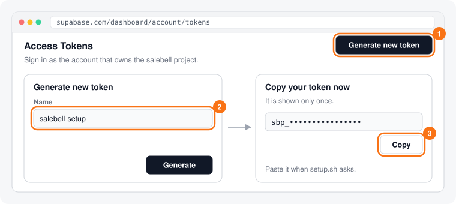
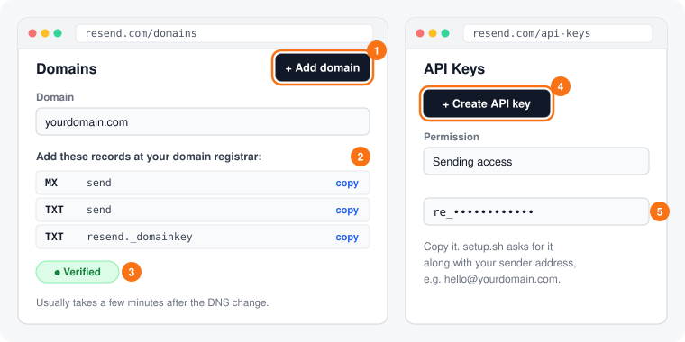
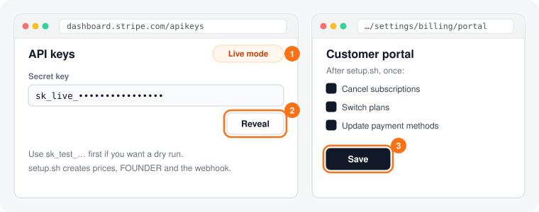
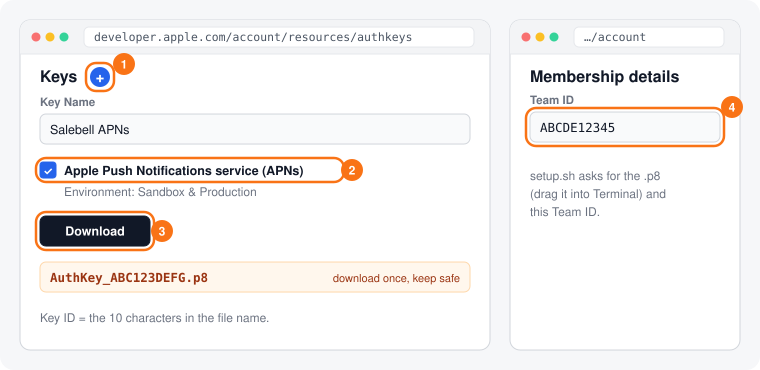

# Getting started and launch setup

## Production self-hosting

Use [the self-hosting guide](SELF_HOSTING.md) for a production installation on your own infrastructure. It requires no Stripe or Salebell Cloud subscription and uses a separate Docker Compose stack. The sections below cover development, app connection and optional managed-cloud administration.

To run your own unrestricted instance on Vercel and hosted Supabase, follow [Vercel and Supabase deployment](VERCEL_SUPABASE_DEPLOYMENT.md), including backend migrations, functions and owner creation. Importing the web app alone does not install the backend.

## Develop locally

Install Node.js **22.6+**, Supabase CLI **2.90+** and Docker Desktop (or a compatible Docker daemon). Start Docker, then run this from the repository root:

```bash
npm run dev
```

The command installs web dependencies on first use, starts local Supabase, applies migrations, selects self-hosted mode, fills `web/.env.local` with local public values, and runs the web app and Edge Functions together. Use `npm run dev -- --cloud` to test cloud Free/Pro locally. No hosted account, SMTP sender, Stripe key or Apple key is needed to try sign-in and add an app.

| Open | Purpose |
|---|---|
| http://localhost:3000 | Website and dashboard |
| http://127.0.0.1:54324 | Local email inbox: open the email and copy its six-digit sign-in code |
| http://127.0.0.1:54323 | Supabase Studio: inspect local users and data |

Press Ctrl+C to stop the web and function processes. The database stays running with your data; `npm run dev:stop` stops its containers. `npm run dev -- --setup-only` prepares the stack without starting the two development servers. On an existing checkout, run `npm ci --prefix web` after dependency changes.

If `web/.env.local` points at a hosted project, move it aside and rerun the command. Local startup preserves optional settings, refreshes local connection values, and never reads `.env.setup`. `supabase/config.toml` configures local Auth; hosted Auth is configured separately below.

Localhost cannot receive real App Store notifications. Use a hosted deployment for the Apple connection test. iPhone push and real checkout also need their hosted provider setup; the dashboard and email-code flow work locally without them.

## Connect your first app as a customer

Sign in with an email code; your workspace is created automatically. Returning signed-in visitors to the homepage go directly to `/app`.

The default **Add app** flow has one task at a time:

1. In **Import your iOS app**, select a saved **App Store Connect API key** or upload its `.p8` and press **Load my iOS apps →**. Create a team key with **Access: App Manager** (recommended) or **Admin**; an Apple Account Holder or Admin must generate it. Apple's filename can supply the Key ID. Enter the Issuer ID once; a known key or single saved team reuses it. Choose the matching team when several are saved. Credential JSON can supply all required fields.
2. Tap your app to continue immediately. Search helps with longer lists; selection does not save the app or use a plan slot.
3. Check the app and any existing server, then press **Start receiving notifications**. URL cards are under **Connection details**; **Your server** shows App Store → Salebell → your server. Supported existing destinations stay connected through forwarding. Changed Apple settings stop setup for renewed review; retries reuse the saved app.
4. **Check your connection** shows receipt status and the optional **Send an App Store test notification** form. Its key selector offers saved encrypted **In-App Purchase keys**, a new upload, or one-time use. The test remains visible after a notification arrives. Go to the dashboard or choose **Set up alerts (optional) →** anytime; recording does not require alerts.

Saved keys can be replaced or deleted, and **Enter app details manually** remains available. iOS / App Store is selected by default; choose Android for the Google Play preview. [Apple automation and key permissions](APPLE_AUTOMATION.md).

Manual setup remains available:

1. Open Salebell, choose **Start free**, and enter your email. Paste the six-digit code from the email; your workspace is created automatically.
2. Choose **Enter app details manually**, then add your app's bundle ID and name. If you already have server URLs in App Store Connect, expand **Keep your existing server connected**, enter its URLs and save them before changing Apple. Copy Salebell's Production and Sandbox URLs to **App Store Connect → your app → App Information → App Store Server Notifications**, choosing **Version 2** for both. Press **I've saved both URLs →**.
3. **Check your connection**, then set up optional alerts or continue to the dashboard while Apple connects. Status updates when a verified notification arrives. Make a sandbox in-app purchase or use the visible Apple test with an In-App Purchase key. An accepted test request can still be pending or fail delivery. Return to Setup any time to check progress.

Keys are optional for manual setup. An App Store Connect team key enables automatic configuration; a separate In-App Purchase key enables requesting an Apple test. Purchase-testing keys can also be saved encrypted, or used for one request. Alert integrations can be added later. The iPhone app is optional. Cloud users can install its configured distribution link; self-hosted operators build a companion for their backend and APNs identity. [iPhone setup](../ios/README.md#self-hosted-companion).

For Android, choose **Add app → Android**, enter the package name, upload a service-account JSON key and configure Pub/Sub. Finish by saving the topic in Play Console and sending a test. Keys are encrypted; connection status confirms actual receipt. [Google setup and required permissions](GOOGLE_PLAY_RTDN.md).

## Configure a hosted deployment as the owner

The hosted project must already have its migrations, functions and web deployment. This script configures Auth and provider credentials; it does not deploy code. Public web values belong in Vercel; provider secrets belong in Supabase Edge Function secrets. Never put a service-role key in `NEXT_PUBLIC_*` values.

First configure the web environment from [`web/.env.example`](../web/.env.example). Use your own project reference and site URL:

```bash
npm run setup:owner -- --project-ref YOUR_PROJECT_REF --site-url https://your-site.example
```

The script asks which steps to run and hides credentials as you type. It does **not** load an existing `.env.setup` automatically. For repeatable setup, create the gitignored credentials file once:

```bash
cp .env.setup.example .env.setup
# Fill in the target and only the provider credentials you need.
npm run setup:owner -- --env-file .env.setup --check
npm run setup:owner -- --env-file .env.setup --steps auth,email
```

`--check` shows the target and whether required credentials are present without calling remote services. `--steps auth,email,stripe,push` chooses any subset. Add `--yes` to an explicit `--env-file` command for unattended application; steps with missing credentials are skipped. An existing Stripe webhook also needs its `STRIPE_WEBHOOK_SECRET` on reruns because Stripe only returns the signing secret when the endpoint is created.

The env file is parsed as dotenv data. Quotes and paths with spaces are supported; shell commands and substitutions are never executed. Credentials are sent via protected temporary files and environment variables, and the script removes its temporary files on exit. Keep `.env.setup` and `.p8` keys out of source control.

## Launch priorities

Customer sign-in is the first dependency. Billing and iPhone push can be configured after people can sign in and connect an app. These are verification items, not a live status report:

| Order | Requirement | Verify |
|---|---|---|
| 1 | Auth URLs, Resend sender and both code email templates | A new customer email outside the Supabase team receives a code and reaches the dashboard |
| 2 | Apple notification connection | A verified sandbox notification marks the app connected |
| 3 | Stripe prices, webhook, secrets and Customer Portal | Test checkout upgrades the workspace; the portal opens |
| 4 | APNs credentials and iPhone app distribution | A physical iPhone receives a test alert |
| 5 | Public support/legal details and iPhone app link | Footer, legal pages and install link show the intended details |

### Auth and email (`--steps auth,email`)

Create a Supabase access token in the account that owns the intended project at https://supabase.com/dashboard/account/tokens. `auth` sets the hosted site origin, redirect allow-list and 15-minute, six-digit codes, and saves `SITE_URL` as an Edge Function secret for automatic Apple configuration.



For customer delivery, verify a domain you own in Resend, then create an API key and choose a sender such as `hello@yourdomain.com`. The `salebell.vercel.app` address cannot be your sender domain. `email` replaces the project's SMTP configuration with Resend and installs the code email for both new and returning users from [`supabase/templates/otp.html`](../supabase/templates/otp.html).



Supabase's built-in sender is limited to authorized team email addresses. A successful sign-in by the owner alone does not prove that customers can receive codes. Verify with a fresh email address outside that team before launch.

### Billing (`--steps stripe`)

Start with a Stripe **test-mode** secret key. The script creates or reuses Salebell Pro ($9/month and $79/year), the `FOUNDER` promotion code and the webhook for the explicitly selected Supabase project. It saves the four Stripe secrets plus `SITE_URL` to that project. Existing subscriptions keep their original prices.



Open https://dashboard.stripe.com/settings/billing/portal in the matching Stripe mode and save the Customer Portal configuration. On a test deployment using test-mode keys, complete checkout with `4242 4242 4242 4242`, confirm the workspace becomes Pro, and open **Manage billing**. Configure live-mode credentials separately for launch.

### iPhone push (`--steps push`)

Create an APNs signing key at https://developer.apple.com/account/resources/authkeys/add using an Apple Developer team role with permission to manage keys. Download the `.p8`, note its key ID and copy the 10-character Team ID from Membership. The key file is only downloadable once.



The script stores the four `APNS_*` secrets. Set `DEVELOPMENT_TEAM` in `ios/Config/Base.xcconfig` to the same team before device builds. See [`ios/README.md`](../ios/README.md) for signing and distribution. Test on a physical iPhone: sign in with the same account, allow notifications, then use **Send a test cha-ching**.

### Public launch details

Set `NEXT_PUBLIC_SUPPORT_EMAIL`, `NEXT_PUBLIC_COMPANY_NUMBER` and `NEXT_PUBLIC_COMPANY_ADDRESS` on Vercel and redeploy. Cloud download links always use [Salebell on the App Store](https://apps.apple.com/app/id6822787827). Self-hosted operators can set `NEXT_PUBLIC_IOS_APP_URL` to their own companion's App Store or TestFlight link and redeploy.

### Deploy saved Apple connections

The credential flow needs both new migrations and the new functions before deploying the web UI. From the repository root, targeting the intended Supabase project explicitly:

```bash
supabase link --project-ref YOUR_PROJECT_REF
supabase db push --linked
supabase functions deploy apple-credentials --project-ref YOUR_PROJECT_REF --use-api
supabase functions deploy apple-connect --project-ref YOUR_PROJECT_REF --use-api
supabase functions deploy apple-test --project-ref YOUR_PROJECT_REF --use-api
npm run setup:owner -- --project-ref YOUR_PROJECT_REF --site-url https://your-site.example --steps auth
```

The migrations create private credential metadata, Supabase Vault storage and guarded forwarding functions. They require the real Vault extension on the deployment. No separate encryption key is needed. Then deploy `web/` to the verified Vercel `salebell` project. Confirm that an owner can upload, reuse, replace and delete a test connection, and that another workspace cannot access it. [Full automation contract](APPLE_AUTOMATION.md).

Verify Vault lifecycle and workspace isolation on your own deployment. `npm run deploy:db` and `npm run deploy:functions` operate on the explicitly linked project; verify the target before each deployment.

## Common first-run problems

| Symptom | Next step |
|---|---|
| Docker is not running | Start Docker Desktop, then rerun `npm run dev` |
| Supabase CLI is missing | Install the Supabase CLI, then rerun `npm run dev` |
| Local code email never reaches your real inbox | Read the local inbox at http://127.0.0.1:54324 |
| Hosted customer receives no code | Verify Resend domain/sender and run the `email` step; check Auth email delivery logs |
| Code has expired | Request a new code; codes last 15 minutes |
| Unattended Stripe rerun needs a webhook secret | Reveal the existing endpoint's signing secret, fill `STRIPE_WEBHOOK_SECRET`, rerun only `stripe` |
| Apple cannot reach a local notification URL | Use the HTTPS hosted deployment for Apple tests |
